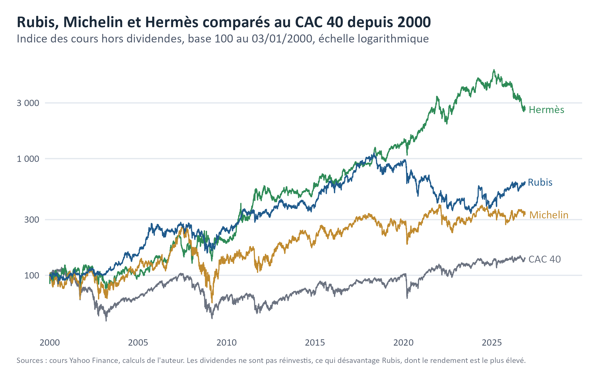
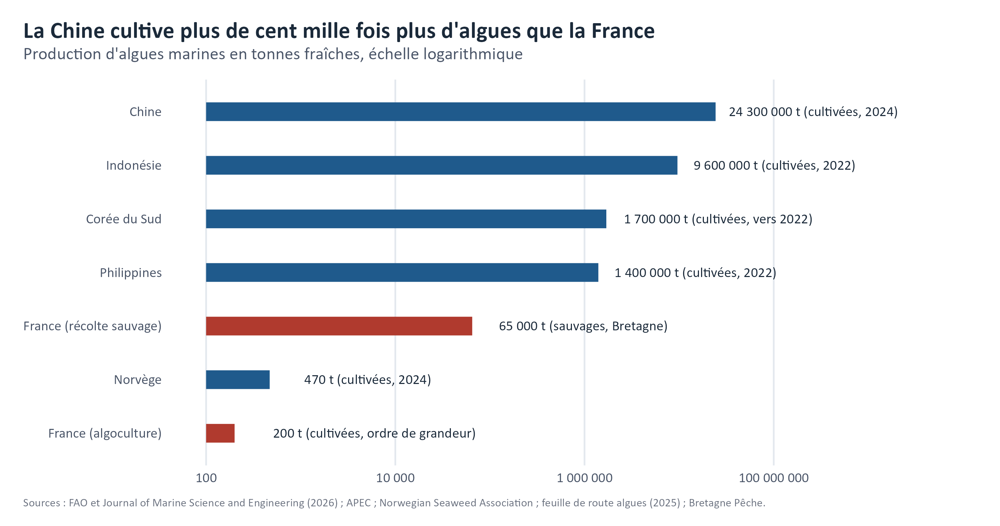
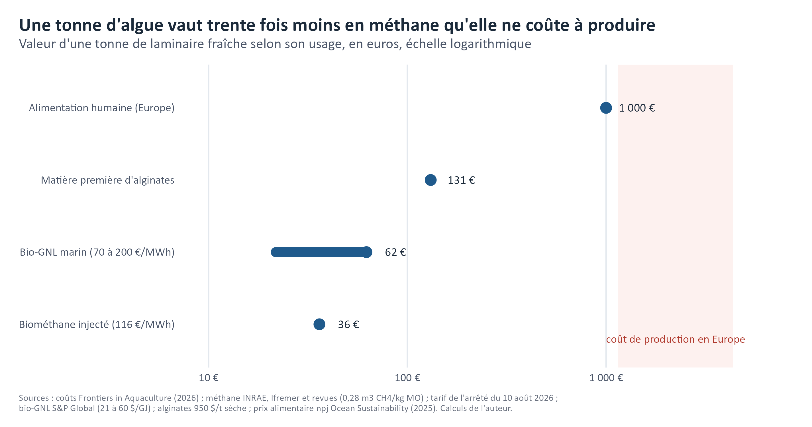
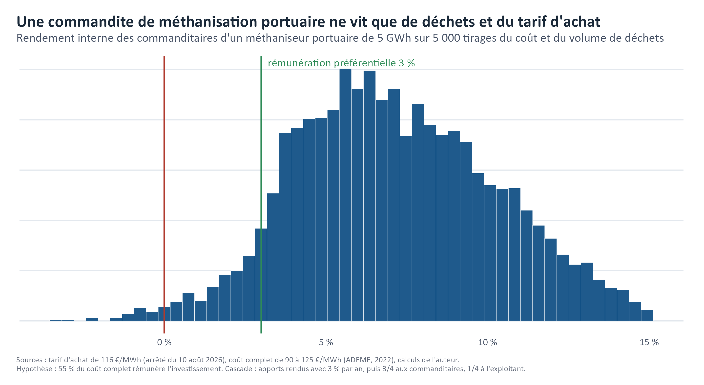

# Une commandite pour la France

Ce projet clôt une série consacrée à trois domaines où la France produit sur le temps long, l'énergie, la mer et la
terre. Chacun des projets précédents aboutissait au même constat financier. Un parc solaire, un chantier naval ou une
parcelle plantée de noyers rapportent, mais ils rapportent tard, souvent bien après l'échéance des prêts que les banques
savent consentir. Le projet consacré à la terre l'avait chiffré de façon nette, puisqu'un hectare de blé associé à des
noyers dégage de 1 000 à 2 800 € de plus qu'un hectare de blé seul, alors que sa trésorerie reste négative pendant
quarante-quatre ans. Le frein tient donc moins à la rentabilité qu'à la forme du capital disponible.

Or il existe en droit français une forme de société conçue précisément pour réunir des capitaux patients et des
exploitants qui s'engagent sur la durée, la **société en commandite**. Ses commanditaires apportent l'argent et ne
répondent des pertes qu'à hauteur de leur apport, tandis que ses commandités dirigent l'affaire et en répondent sur tous
leurs biens. Cette forme recule pourtant là où elle subsistait encore. Lagardère l'a abandonnée en 2021, et Rubis, groupe
d'énergie coté à Paris qui en était l'un des derniers grands exemples, propose à son tour de devenir une société
anonyme lors de l'assemblée générale du **9 décembre 2026**.

Le projet procède en trois temps. Il retrace d'abord l'histoire de ce contrat, de la *commenda* des marchands de Venise et
de Gênes jusqu'au Code de commerce. Il mesure ensuite ce que valait, chez Rubis, le droit des associés commandités, en
reproduisant la formule de l'article 56 des statuts puis en simulant vingt mille trajectoires du cours de bourse, afin de
le comparer à l'indemnité proposée. Il se tourne enfin vers la mer, regarde ce que la Chine et les autres pays font de
leurs algues, se demande si la France peut suivre, et construit une commandite portuaire qui transforme les déchets marins
en gaz.

> Au moment de la rédaction (26 novembre 2026), la transformation de Rubis reste un **projet soumis au vote** des
> actionnaires et à une décision de l'AMF. Le résultat de l'assemblée du 9 décembre sera ajouté ici.

## 1. Un contrat né sur la mer

La commandite descend d'un contrat de commerce maritime, la *commenda*, que l'on trouve à Gênes, à Pise et à Venise à
partir du XIe siècle ; la *colleganza* vénitienne apparaît pour la première fois dans un acte de 1073. Un marchand
sédentaire, le *stans*, confiait de l'argent ou des marchandises à un marchand voyageur, le *tractator*, qui embarquait,
vendait et rachetait outre-mer. Dans la forme dite unilatérale, le premier fournissait tout le capital et recevait les
trois quarts du bénéfice, le second apportant son travail et son risque personnel contre le quart restant. Dans la forme
bilatérale, le voyageur apportait un tiers du capital et le bénéfice se partageait par moitié. Le sédentaire ne perdait
jamais plus que sa mise, ce qui permettait à des veuves, à des clercs ou à des artisans de placer leur épargne dans le
grand commerce sans connaître la mer.

Ce partage entre celui qui finance et celui qui conduit n'était d'ailleurs pas propre au négoce. À terre, le **bail à
cheptel** confiait un troupeau à un preneur qui le nourrissait et partageait le croît avec le bailleur, et le
**métayage** divisait la récolte entre le propriétaire du sol et celui qui le travaillait. En mer, la pêche artisanale
rémunère encore ses équipages **à la part**, c'est-à-dire par une fraction de la vente du poisson une fois déduits les frais
communs. Le principe est chaque fois le même, puisque le revenu de chacun dépend du résultat et que personne ne touche de
salaire fixe tant que la récolte, le croît ou la marée n'est pas vendu.

La France a ensuite donné à ce contrat un cadre juridique. L'ordonnance sur le commerce de 1673, dite code Savary,
reconnaît la société en commandite, et le Code de commerce de 1807 crée la **commandite par actions**, dont les parts des
commanditaires peuvent circuler. Comme la société anonyme exigeait alors une autorisation du gouvernement, la commandite par
actions a financé une bonne part de l'industrie française de la première moitié du XIXe siècle, jusqu'à ce que la loi du
24 juillet 1867 libère la création des sociétés anonymes. Elle a depuis survécu dans quelques maisons qui y voyaient
surtout un moyen de garder le contrôle sur plusieurs générations, comme Michelin, Hermès, Rothschild & Co ou Touax.

## 2. Rubis, trente ans de commandite

Rubis a été fondé en 1990 par Gilles Gobin et Jacques Riou. Le groupe stocke et distribue des produits pétroliers et du
gaz liquéfié en Europe, dans les Caraïbes et en Afrique, et il s'est engagé depuis 2022 dans l'électricité renouvelable
avec Photosol, développeur français de centrales solaires. En 2025, il a réalisé un chiffre d'affaires de 6 534 M€ et un
résultat net part du groupe de 309 M€, et il a augmenté son dividende pour la trentième année consécutive.

Dans cette commandite, les associés commandités sont trois sociétés familiales des fondateurs (Agena, GR Partenaires et
Sorgema), qui détenaient 2,3 % du capital à la fin de 2025. Ils nomment la gérance, ne peuvent être évincés par les
actionnaires et disposent d'un droit de veto sur les modifications des statuts. Ils perçoivent en outre un dividende
statutaire, qui fait l'objet de la section suivante.

Sur la durée, ce montage n'a pas desservi les actionnaires. Depuis 2000, le cours de Rubis a été multiplié par plus de
six, hors dividendes, alors que celui du CAC 40 n'a progressé que de 38 %. Les deux grandes commandites du CAC 40 font
également mieux que l'indice, Michelin étant multiplié par plus de trois et Hermès par vingt-six. Ce graphique ne prouve
pas que la forme juridique soit la cause de ces performances, car trois entreprises ne forment pas un échantillon, mais il
montre au moins qu'elle n'a pas empêché de créer de la valeur.



## 3. Ce que valait le droit des commandités

L'article 56 des statuts attribue aux commandités **3 % de la performance boursière** de l'exercice, plafonnés à **10 %
du résultat net part du groupe**. La performance se calcule par action comme l'écart entre la moyenne des cours de clôture
des vingt dernières séances de l'exercice et le plus haut des trois exercices précédents, augmenté des dividendes versés
depuis, puis elle est multipliée par le nombre d'actions. Les commandités ne touchent donc rien les années où le cours
reste sous son plus haut récent, ce qui fut le cas de 2020 à 2023.

Le script reproduit cette formule à partir des cours publics. Pour 2025, il retrouve un montant de 42,5 M€ avant
plafond, si bien que le plafond de 30,9 M€ s'applique, comme dans les comptes publiés. Pour 2024, il encadre le montant
publié de 11,3 M€ entre 8,9 et 14,5 M€ selon que l'on compte ou non le dividende de l'exercice de référence, le texte des
statuts laissant ce point ambigu. Il retrouve enfin qu'aucun montant n'était dû de 2020 à 2023. Sur les vingt-quatre
exercices calculables, la performance a été positive quinze fois.


Pour valoriser ce droit, il faut ensuite le traiter comme une suite d'options, puisque chaque année les commandités
reçoivent une fraction de la hausse du cours sans rien perdre en cas de baisse. Le script simule donc vingt mille
trajectoires du cours de Rubis sur soixante ans, avec la volatilité historique de 26 %, un rendement attendu de 8 % et une
croissance du résultat de 2 % par an pour faire évoluer le plafond, puis il actualise les montants versés dans chaque
trajectoire. La valeur moyenne obtenue est de **116 M€**, avec une médiane de 106 M€ et un intervalle de 36 à 208 M€ entre
le premier et le dernier décile.


Le résultat dépend peu des hypothèses retenues. En faisant varier le rendement attendu de 6 à 10 % et la croissance du
résultat de 0 à 4 %, la valeur moyenne reste comprise entre 95 et 134 M€.

| Rendement attendu | Croissance 0 % | Croissance 2 % | Croissance 4 % |
|---|---|---|---|
| 6 % | 105 M€ | 120 M€ | 134 M€ |
| 8 % | 100 M€ | 115 M€ | 131 M€ |
| 10 % | 95 M€ | 110 M€ | 126 M€ |

L'indemnité proposée aux commandités se situe en revanche bien au-dessus. Le projet annoncé le 19 octobre leur attribuait
12,7 millions d'actions nouvelles, soit environ 465 M€ au cours de 36,58 €, et les termes revus le 18 novembre ramènent ce
nombre à 11,4 millions d'actions, soit environ 416 M€, tout en prévoyant une distribution exceptionnelle de 1,50 € par
action existante, d'environ 155 M€, réservée aux actionnaires actuels. Même la variante la plus favorable du modèle, qui
compte le dividende de l'exercice de référence, n'atteint que 144 M€. Seule une hypothèse extrême, où le plafond de 10 % du
résultat serait atteint chaque année sans exception, porterait la valeur du droit à 525 M€, alors qu'il ne l'a été qu'une
fois en six ans.

## 4. L'écart correspond au prix du contrôle

L'écart de quelque 300 M€ ne signifie pas pour autant que l'indemnité soit injustifiée, car les commandités ne cèdent pas
seulement un dividende. Ils renoncent aussi au pouvoir de nommer la gérance sans l'accord des actionnaires et à un veto sur
toute modification des statuts. L'assemblée de 2025 en avait donné un exemple concret, puisque la gérance avait refusé
d'inscrire à l'ordre du jour une résolution d'actionnaire visant à modifier l'article 56, faute d'accord des commandités.
L'expert indépendant mandaté par Rubis, le cabinet Ledouble, a d'ailleurs retenu une fourchette de 11,0 à 12,3 % du
capital, et le nouvel accord se place au bas de cette fourchette.

Ce verrou a également un prix pour les actionnaires, qui ne peuvent recevoir d'offre de rachat tant que la commandite
subsiste. Le précédent de Lagardère l'illustre bien, puisque la société a abandonné sa commandite en 2021 contre 10
millions d'actions remises à Arnaud Lagardère, soit 7,6 % du capital, avant de passer sous le contrôle de Vivendi deux ans
plus tard. Pour Rubis, certains analystes évoquent une hypothèse comparable au profit du groupe Bolloré, déjà présent au
capital, mais rien ne permet aujourd'hui de l'affirmer. En définitive, l'écart entre 116 et 416 M€ mesure la valeur que
les actionnaires attachent à la fin du verrou, et c'est en cela qu'il constitue le prix du contrôle.

Cette critique de la commandite mérite d'être prise au sérieux. La forme protège les dirigeants contre les actionnaires
autant qu'elle les protège contre les prédateurs, et les études de marché observent souvent une décote des sociétés
contrôlées de cette façon. Elle n'a de sens que si la gérance s'engage réellement sur le long terme, ce que les fondateurs
de Rubis ont fait pendant trente-six ans, mais qu'aucun statut ne garantit au-delà d'une génération.

## 5. Une commandite pour la mer

Le défaut que les marchés reprochent à la commandite devient en revanche une qualité lorsque l'actif est long et que son
exploitant doit rester en place pendant des décennies. La mer offre précisément ce type d'actifs, qu'il s'agisse d'une
ferme marine, d'un port ou d'une unité qui transforme ses déchets en énergie, et c'est d'ailleurs en mer que la
*commenda* est née. L'idée examinée ici est donc celle d'une filière qui cultiverait des algues, les transformerait en gaz
par méthanisation et s'appuierait sur les infrastructures portuaires et sur l'aquaculture. Avant de la chiffrer, il faut
toutefois regarder ce que font les pays qui cultivent déjà la mer.

### Ce que fait la Chine

La Chine a cultivé environ **24,3 millions de tonnes** d'algues fraîches en 2024, soit près de 63 % de la production
mondiale, estimée à 38,8 millions de tonnes. La laminaire japonaise (*Saccharina japonica*) en représente à elle seule
12,6 millions de tonnes, et la Chine en fournit plus de 90 % de la production mondiale. Depuis 2018, l'État a fait de
l'aquaculture une priorité nationale sous le nom de « grenier bleu », avec plus de 180 « ranchs marins » de niveau
national, des plateformes d'élevage en haute mer qui produisaient déjà 500 000 tonnes en 2024, et un quinzième plan
quinquennal (2026-2030) qui regroupe ces dispositifs dans une nouvelle catégorie de « ranchs au large ».

Ce qui frappe pourtant le plus, c'est l'usage que la Chine fait de cette biomasse. Elle ne la cultive pas pour en tirer de
l'énergie, mais pour se nourrir, pour en extraire des alginates et surtout pour **nourrir la mer elle-même**. Dans la baie
de Sanggou, dans le Shandong, la laminaire sert à la fois d'aliment aux ormeaux et de filtre qui absorbe leurs rejets
dissous, tandis que les holothuries, placées dans les mêmes cages, consomment les particules qui tombent au fond. Cette
aquaculture dite multitrophique, pratiquée aussi au Fujian, fait de l'algue la base d'une chaîne alimentaire cultivée,
dans laquelle chaque espèce valorise les déchets de la précédente. La Chine s'est par ailleurs dotée en 2023 d'une méthode
de comptabilité du carbone océanique et estime que ses cultures d'algues auraient évité 35 à 73 millions de tonnes de CO2
entre 2003 et 2021. Ce chiffre reste toutefois une estimation de modèle, et l'organisme de certification Verra refuse pour
l'instant de délivrer des crédits carbone pour la culture des laminaires.

### Ce que font les autres pays

L'Indonésie cultive près de 10 millions de tonnes d'algues rouges, destinées pour l'essentiel aux carraghénanes, et la
Corée du Sud et les Philippines en produisent chacune entre 1,4 et 1,7 million de tonnes. L'Europe reste en revanche à
l'état de pilote. La Norvège comptait 566 concessions d'algoculture en 2024, mais n'en a récolté que 470 tonnes. La France récolte
entre 60 000 et 70 000 tonnes d'algues sauvages par an, en Bretagne pour 95 %, mais n'en cultive que quelques centaines de
tonnes. La feuille de route nationale de février 2025 vise 1 000 tonnes en 2027, alors que le programme breton Breizh'alg
visait déjà 25 000 à 50 000 tonnes il y a plus de dix ans.



### Ce que vaut une tonne d'algue

La question décisive est donc celle de la valeur d'une tonne d'algue selon son usage. Une tonne de laminaire sucrée
fraîche contient environ 15 % de matière sèche, dont les deux tiers sont organiques, et produit en méthanisation près de
0,28 m3 de méthane par kilogramme de matière organique, ce qui donne **0,31 MWh** de gaz. Au tarif d'achat du biométhane
injecté, cela représente 36 € par tonne, et entre 22 et 62 € si l'on vend ce gaz liquéfié aux navires. La même tonne vaut
131 € comme matière première d'alginates et environ 1 000 € sur le marché alimentaire européen, alors qu'elle coûte entre
**1 150 et 4 370 €** à produire en Europe selon une étude de 2026.



La méthanisation d'algues cultivées pour elles-mêmes ne peut donc pas être rentable, puisque le gaz rapporte de 32 à 121
fois moins que ce que coûte l'algue. L'échelle le confirme d'ailleurs, car la totalité de la récolte française méthanisée
ne donnerait que 20 GWh, soit la production de quatre petits méthaniseurs, et la production chinoise entière n'en
donnerait que 7,6 TWh. Il n'est pas étonnant, dès lors, qu'aucun pays ne cultive les algues pour l'énergie. Le gaz ne peut
venir que de ce qui reste une fois les usages les plus rémunérateurs servis, c'est-à-dire des résidus d'extraction des
alginates, qui produisent encore 0,19 m3 de méthane par kilogramme de matière organique, et des déchets que la mer et les
ports produisent de toute façon.

### Une commandite portuaire

Ces déchets existent pourtant en quantité. Les communes des Côtes-d'Armor ont ramassé 14 000 tonnes d'algues vertes
échouées en 2024 et 8 000 tonnes en 2025, et l'État finance la totalité de ce ramassage et la moitié de leur traitement.
Le mareyage transforme en coproduits de 30 à 60 % du poisson débarqué, et le port de Boulogne-sur-Mer en méthanise déjà
une partie depuis 2009. Le gaz produit peut ensuite trouver trois débouchés au port, à savoir l'injection dans le réseau,
le bio-GNL pour les navires, que le règlement européen FuelEU Maritime rend nécessaire puisqu'il impose de réduire
l'intensité carbone des carburants marins de 2 % en 2025, de 6 % en 2030 et de 80 % en 2050, et enfin la chaleur, qui peut
servir à l'aquaculture comme à Gravelines, où une ferme de bars et de daurades produit de 1 500 à 2 000 tonnes par an
grâce à une eau réchauffée.

Le modèle construit donc une commandite autour d'un méthaniseur portuaire de 5 GWh par an, alimenté par ces déchets et par
les résidus d'algues. Les commanditaires, qui pourraient être le port, une banque régionale, des épargnants ou un
distributeur d'énergie, financent l'investissement, estimé à 2,9 M€. L'exploitant, par exemple une coopérative de
pêcheurs ou d'algoculteurs, devient commandité. Le gaz est vendu 116 € par MWh, au tarif d'achat fixé par l'arrêté du
10 août 2026 pour les petites unités, et le coût complet de production retenu est celui de l'ADEME, de 90 à 125 € par MWh.
La répartition suit, comme pour les marchands de Venise, l'ordre de la *commenda* unilatérale, puisque les commanditaires
récupèrent d'abord leurs apports capitalisés à 3 % par an avant de partager le surplus à raison de trois quarts pour eux
et d'un quart pour l'exploitant.

Dans le cas central, le projet dégage une marge d'exploitation de 338 000 € par an et un rendement interne de 8,1 %. Les
commanditaires obtiennent **7,2 %** et l'exploitant reçoit 427 000 € sur quinze ans sans avoir rien avancé. En tirant cinq
mille fois le coût de production et le volume de déchets, le rendement médian des commanditaires atteint 6,9 %, compris
entre 3,5 et 11,4 % du premier au dernier décile, et la probabilité de perte n'est que de 1 %.



Ce résultat repose néanmoins sur deux conditions qu'il faut énoncer clairement. La première est que l'unité ne vit que de
déchets, puisque 5 GWh exigeraient à eux seuls près de 24 000 tonnes de résidus d'algues, soit cent fois la production
française actuelle d'algues cultivées. La seconde est le tarif d'achat lui-même, dont le guichet ouvert se ferme le
31 décembre 2026, après quoi les projets passeront par des appels d'offres ou par des certificats de production de
biogaz, dont la valeur n'est pas encore connue.

Le cas de Rubis éclaire enfin cette piste d'une autre manière. Le groupe détenait 55 % de Rubis Terminal, devenu Tepsa,
premier opérateur de stockage portuaire de France avec 4 millions de mètres cubes de capacité, et il a cédé cette
participation au fonds I Squared Capital en octobre 2024 pour se concentrer sur la distribution d'énergie et
l'électricité renouvelable. Les infrastructures portuaires, qui sont par nature des actifs longs, sont ainsi passées d'une
commandite familiale à un fonds d'infrastructure, ce qui illustre bien la question que pose ce projet.

### La France peut-elle suivre ?

La France ne peut pas suivre la Chine sur les volumes. Ses coûts de main-d'œuvre, la concurrence des usages sur son
littoral et la petite taille de sa filière l'en empêchent pour longtemps, et l'écart entre les objectifs de Breizh'alg et
la production réelle montre que les plans de culture massive n'ont pas tenu. Elle peut en revanche suivre la Chine sur la
méthode, en associant les algues aux élevages de coquillages qui occupent déjà son littoral pour produire de la biomasse
destinée à la mer plutôt qu'à l'énergie, et en
faisant de ses ports des lieux où les déchets marins deviennent du gaz pour les navires et de la chaleur pour
l'aquaculture. C'est à cette échelle, celle d'un port et de ses exploitants, que la commandite retrouve tout son sens.

## 6. Ce que cela donne ensemble

Au terme de cette série, l'énergie, la mer et la terre se rejoignent sur un point. Les actifs qui les portent produisent
sur quinze, trente ou quarante-cinq ans, alors que le système financier français sait surtout prêter à cinq ou sept ans
et que l'épargne des ménages reste majoritairement placée sur des supports liquides. La commandite apporte une réponse
ancienne à ce décalage, puisqu'elle associe celui qui attend et celui qui travaille sans imposer de calendrier de
remboursement.

Le cas de Rubis montre que cette forme sait durer et créer de la valeur, mais il montre aussi qu'elle coûte cher à défaire
dès lors qu'elle sert à verrouiller le pouvoir plus qu'à porter un actif. Il ne s'agit donc pas de la défendre pour
elle-même. Il s'agit plutôt de la réserver aux situations où l'engagement de durée de l'exploitant constitue l'actif
lui-même, ce qui est le cas d'un port et de ses pêcheurs bien davantage que celui d'un groupe coté.

## Limites

- La formule de l'article 56 est reproduite à partir de cours publics ajustés des divisions d'actions. Les montants
  recalculés de performance globale s'écartent des montants officiels (1 415 M€ contre 1 479 M€ en 2025, 298 M€ contre
  376 M€ en 2024), sans que cet écart change le plafond ni le signe du résultat.
- La simulation suppose un cours log-normal à volatilité constante et un dividende proportionnel au cours. Elle ignore
  l'obligation de bloquer la moitié du dividende statutaire en actions pendant trois ans et ne valorise pas les droits de
  gouvernance, qui sont précisément l'objet de la section 4.
- Les indemnités sont évaluées au cours du 19 novembre 2026, qui évoluera d'ici l'assemblée.
- La comparaison avec Michelin et Hermès porte sur trois sociétés et ne permet aucune conclusion causale.
- Le coût de production des algues provient d'une seule étude européenne récente, et les potentiels méthane sont des
  mesures de laboratoire, qui varient selon l'espèce, la saison et les prétraitements.
- Les productions par pays mêlent des années (2022 à 2024) et des sources différentes ; le chiffre coréen n'a pas pu être
  vérifié dans les données de la FAO, et la production française cultivée n'est connue qu'en ordre de grandeur.
- Le méthaniseur portuaire repose sur le coût complet publié par l'ADEME en 2022 et sur une hypothèse, celle d'un
  investissement qui représente 55 % de ce coût. Il ignore la fiscalité, les frais de gestion, la redevance qu'un port
  percevrait pour le traitement des déchets et le droit de l'offre au public, qui encadrerait l'appel à des épargnants.
- La transformation de Rubis n'est pas encore votée, et le texte sera mis à jour après le 9 décembre 2026.

## Reproduire

```
Rscript analyse.R
```
Le script lit les cours enregistrés dans `donnees/brut/` (Yahoo Finance), applique l'article 56, lance les simulations
(environ quarante secondes) et écrit les graphiques ainsi que `resultats.txt` et `sensibilite.csv` dans `sorties/`.
Packages R : dplyr, tidyr, ggplot2, scales. Le détail des sources figure dans `SOURCES.md`.

## Sources

- Rubis, [communiqué du 19 octobre 2026](https://www.globenewswire.com/news-release/2026/10/19/3382976/0/fr/rubis-annonce-un-projet-de-transformation-du-groupe-en-societe-anonyme.html)
  et [communiqué du 18 novembre 2026](https://www.24matins.fr/pr/rubis-annonce-levolution-des-termes-de-son-projet-de-transformation-en-societe-anonyme).
- Rubis, [document d'enregistrement universel 2025](https://www.rubis.fr/app/uploads/2026/04/rub2025-urd-fr-.pdf) (sections 5.12.2 et 6.3.2) ;
  [statuts](https://www.pappers.fr/entreprise/rubis-784393530/documents/RUBIS%20-%20Statuts%20mis%20%C3%A0%20jour%2025-06-2024.pdf), article 56.
- France Épargne, [« Rubis renonce à la commandite »](https://www.france-epargne.fr/news/rubis-renonce-a-la-commandite-et-promet-127-millions-dactions-a-ses-associes-commandites), 19 octobre 2026 ;
  [Boursorama](https://www.boursorama.com/bourse/actualites/rubis-modifie-les-termes-de-son-projet-de-transformation-en-sa-431be55adc78f9b929e2774459c920aa), 19 novembre 2026 ;
  [BFM Bourse](https://www.tradingsat.com/rubis-FR0013269123/actualites/rubis-reclame-par-de-nombreux-investisseurs-le-projet-de-transformation-de-rubis-en-societe-anonyme-ravive-l-interet-speculatif-pour-le-titre-qui-progresse-de-23-en-bourse-1171969.html).
- Cours : Yahoo Finance (RUI.PA, ML.PA, RMS.PA, ^FCHI).
- Commandites cotées à Paris : [Tradingsat](https://www.tradingsat.com/actualites/informations-societes/avec-lagardere-quelles-sont-les-autres-societes-en-commandite-de-la-bourse-de-paris-965183.html), 2021.
- *Commenda* : J. H. Pryor, « The Origins of the Commenda Contract », *Speculum*, vol. 52, n° 1, 1977 ;
  Y. González de Lara, « Enforceability and Risk-Sharing in Financial Contracts », *Journal of Economic History*, 2001.
- Algues, Chine : [*Engineering Perspectives on Kelp Cultivation Structures in China*](https://doi.org/10.3390/jmse14191794), 2026 ;
  [*IMTA in Sanggou Bay*](https://www.researchgate.net/publication/300002946_Integrated_multi-trophic_aquaculture_IMTA_in_Sanggou_Bay_China) ;
  [Global Seafood Alliance](https://www.globalseafood.org/advocate/sea-cucumbers-enhance-imta-system-with-abalone-kelp-in-china/) ;
  [Palladium](https://www.palladiummag.com/2026/08/04/china-is-building-a-blue-granary/) et [Xinhua](https://english.news.cn/20260425/ffd508ba5d3249888b54abe971c24292/c.html) (ranchs marins) ;
  [*Reconceptualising seaweed cultivation in China*](https://www.tandfonline.com/doi/full/10.1080/17583004.2024.2349941) et [Dialogue Earth](https://dialogue.earth/en/ocean/18729-what-makes-chinas-blue-carbon-plans-different/) (carbone).
- Autres pays : FAO, [*Quarterly seaweed analysis*](https://openknowledge.fao.org/server/api/core/bitstreams/aa6d8412-8825-46e2-b52c-bcf6fb952c83/content), février 2026 ;
  [APEC](https://www.apec.org/apecapi/publication/getfile?publicationId=2597f5ec-e651-4c19-8e46-5c743dbd39bb) ;
  [Norwegian Seaweed Association](https://www.sintef.no/contentassets/832f49925df24b0a84dff2eb5c1f9a7b/m-gjerstad--norwegian-seaweed-association.pdf).
- France : [feuille de route algoculture](https://www.mer.gouv.fr/sites/default/files/2025-02/feuille_de_route_algues_fevrier_2025pdf.pdf), février 2025 ;
  [Bretagne Pêche](https://www.bretagne-peches.org/recolte-dalgues-et-algoculture-en-bretagne/) ;
  préfecture des [Côtes-d'Armor](https://www.cotes-darmor.gouv.fr/Actions-de-l-Etat/Mer-littoral-et-securite-maritime/Algues-vertes-Bilan-2024-perspectives-2025) (algues vertes).
- Coûts et valeur des algues : [*Frontiers in Aquaculture*](https://www.frontiersin.org/journals/aquaculture/articles/10.3389/faquc.2026.1998334/full), 2026 ;
  [*Roadmap to sustainably develop the European seaweed industry*](https://www.nature.com/articles/s44183-025-00122-9), 2025 ;
  [*Frontiers in Marine Science*](https://www.frontiersin.org/articles/10.3389/fmars.2022.948086), 2022 (alginates et résidus).
- Méthane : [*Anaerobic digestion of macroalgae*](https://iwaponline.com/wst/article/64/8/1723/31575/Anaerobic-digestion-of-macroalgae-methane) ;
  [Ifremer](https://archimer.ifremer.fr/doc/00000/4810) et [INRAE](https://hal.inrae.fr/hal-02629401) (ulves).
- Gaz : [arrêté du 10 août 2026](https://www.legifrance.gouv.fr/jorf/id/JORFTEXT000054678196) ; [CRE](https://cre.fr/fileadmin/Documents/Rapports_et_etudes/2024/Rapport_Bilan_technique_economique_biomethane_injecte.pdf) ;
  [S&P Global](https://www.spglobal.com/commodity-insights/en/news-research/latest-news/lng/070924-bio-lng-bunker-fuel-key-to-supporting-lngs-future-in-stricter-maritime-emissions-climate) et [Argus](https://www.argusmedia.com/-/media/project/argusmedia/mainsite/english/documents-and-files/topical-market-themes/alternative-marine-fuels/bio-lng-price-faq.pdf) (bio-GNL, FuelEU Maritime).
- Ports et aquaculture : [Enerzine](https://www.enerzine.com/les-dechets-de-poissons-transformes-en-biogaz/6719-2009-04) (Boulogne-sur-Mer) ;
  [Institut Agro](https://halieutique.institut-agro.fr/files/fichiers/memoires/222309.pdf) (coproduits du mareyage) ;
  [Gloria Maris, Gravelines](https://cpdp.debatpublic.fr/cpdp-portdedunkerque/images/Contributions/Contribution-_AQUANORD_ET_ECLOSERIE_MARINE_DE_GRAVELINES-ICHTUS-21122017.pdf) ;
  Rubis, [cession de Rubis Terminal](https://www.rubis.fr/en/communique/rubis-rubis-completes-the-sale-of-its-55-stake-in-rubis-terminal-now-branded-tepsa/), octobre 2024.
