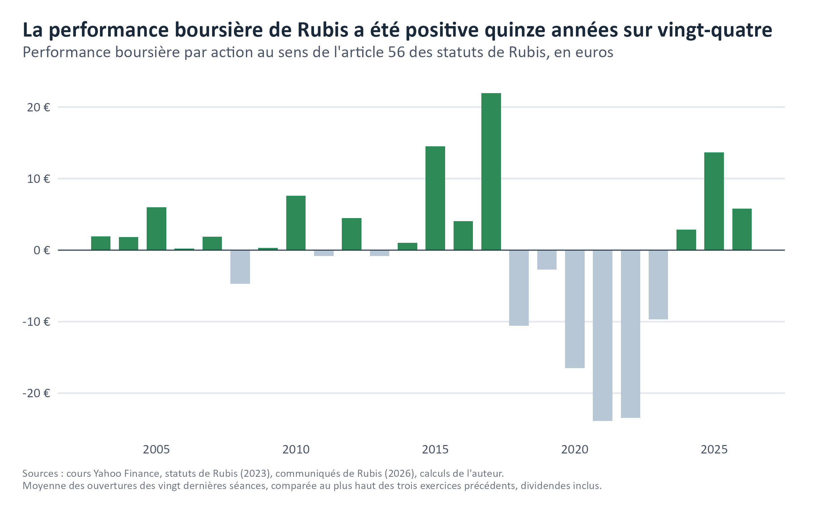
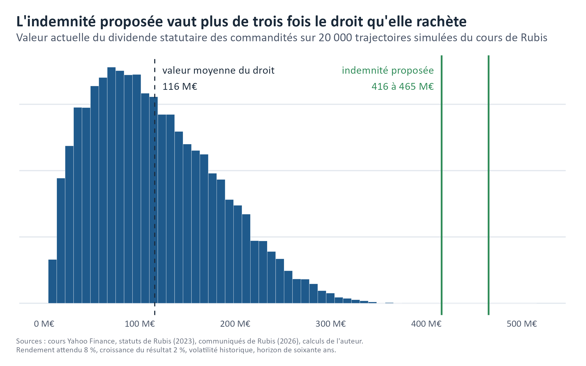
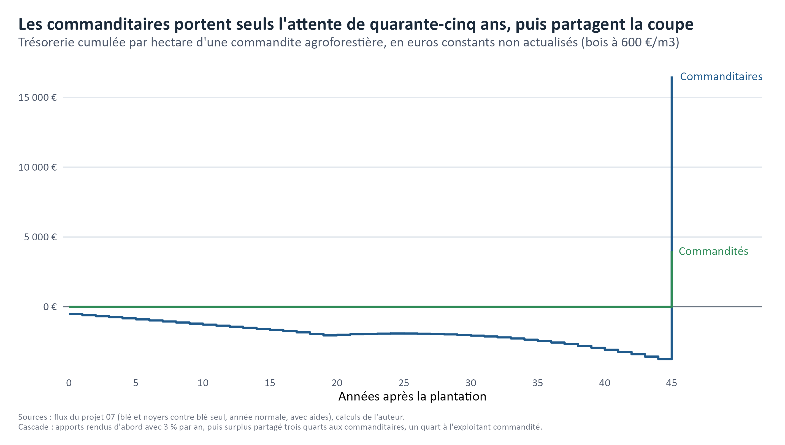
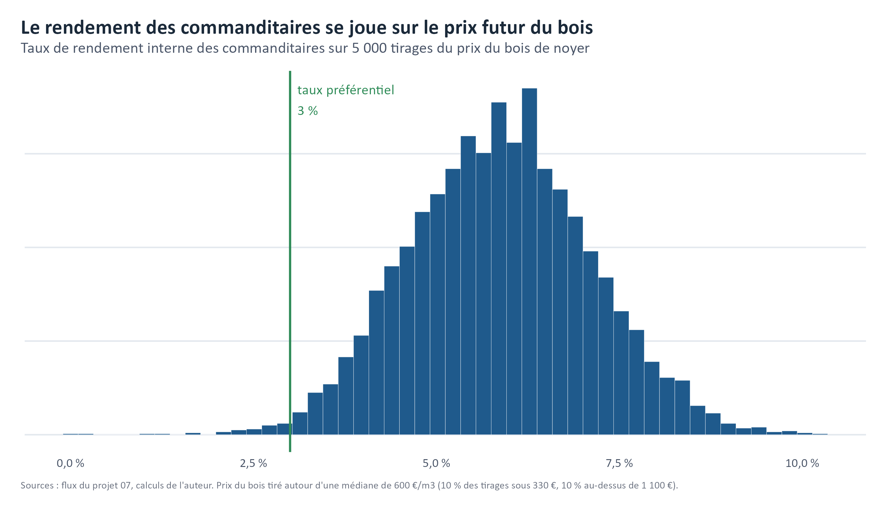

# Une commandite pour la France

Ce projet clôt une série consacrée à trois domaines où la France produit sur le temps long, l'énergie, la mer et la
terre. Chacun des projets précédents aboutissait au même constat financier. Un parc solaire, un chantier naval ou une
parcelle plantée de noyers rapportent, mais ils rapportent tard, souvent bien après l'échéance des prêts que les banques
savent consentir. Le projet consacré à la terre l'avait chiffré de façon nette, puisqu'un hectare de blé associé à des
noyers dégage de 1 000 à 2 800 € de plus qu'un hectare de blé seul, alors que sa trésorerie reste négative pendant
quarante-quatre ans. Le frein tient donc moins à la rentabilité qu'à la forme du capital disponible.

Or il existe en droit français une forme de société conçue précisément pour réunir des capitaux patients et des
exploitants qui s'engagent sur la durée, la **société en commandite**. Ses commanditaires apportent l'argent et ne
répondent des pertes qu'à hauteur de leur apport, tandis que ses commandités dirigent l'affaire et en répondent sur tous
leurs biens. Cette forme recule pourtant là où elle subsistait encore. Lagardère l'a abandonnée en 2021, et Rubis, groupe
d'énergie coté à Paris qui en était l'un des derniers grands exemples, propose à son tour de devenir une société
anonyme lors de l'assemblée générale du **9 décembre 2026**.

Le projet procède en trois temps. Il retrace d'abord l'histoire de ce contrat, de la *commenda* des marchands de Venise et
de Gênes jusqu'au Code de commerce. Il mesure ensuite ce que valait, chez Rubis, le droit des associés commandités, en
reproduisant la formule de l'article 56 des statuts puis en simulant vingt mille trajectoires du cours de bourse, afin de
le comparer à l'indemnité proposée. Il construit enfin une commandite type pour la terre, à partir des flux du projet
précédent, et indique ce qu'il faudrait pour en bâtir une pour la mer.

> Au moment de la rédaction (24 novembre 2026), la transformation de Rubis reste un **projet soumis au vote** des
> actionnaires et à une décision de l'AMF. Le résultat de l'assemblée du 9 décembre sera ajouté ici.

## 1. Un contrat né sur la mer

La commandite descend d'un contrat de commerce maritime, la *commenda*, que l'on trouve à Gênes, à Pise et à Venise à
partir du XIe siècle ; la *colleganza* vénitienne apparaît pour la première fois dans un acte de 1073. Un marchand
sédentaire, le *stans*, confiait de l'argent ou des marchandises à un marchand voyageur, le *tractator*, qui embarquait,
vendait et rachetait outre-mer. Dans la forme dite unilatérale, le premier fournissait tout le capital et recevait les
trois quarts du bénéfice, le second apportant son travail et son risque personnel contre le quart restant. Dans la forme
bilatérale, le voyageur apportait un tiers du capital et le bénéfice se partageait par moitié. Le sédentaire ne perdait
jamais plus que sa mise, ce qui permettait à des veuves, à des clercs ou à des artisans de placer leur épargne dans le
grand commerce sans connaître la mer.

Ce partage entre celui qui finance et celui qui conduit n'était d'ailleurs pas propre au négoce. À terre, le **bail à
cheptel** confiait un troupeau à un preneur qui le nourrissait et partageait le croît avec le bailleur, et le
**métayage** divisait la récolte entre le propriétaire du sol et celui qui le travaillait. En mer, la pêche artisanale
rémunère encore ses équipages **à la part**, c'est-à-dire par une fraction de la vente du poisson une fois déduits les frais
communs. Le principe est chaque fois le même, puisque le revenu de chacun dépend du résultat et que personne ne touche de
salaire fixe tant que la récolte, le croît ou la marée n'est pas vendu.

La France a ensuite donné à ce contrat un cadre juridique. L'ordonnance sur le commerce de 1673, dite code Savary,
reconnaît la société en commandite, et le Code de commerce de 1807 crée la **commandite par actions**, dont les parts des
commanditaires peuvent circuler. Comme la société anonyme exigeait alors une autorisation du gouvernement, la commandite par
actions a financé une bonne part de l'industrie française de la première moitié du XIXe siècle, jusqu'à ce que la loi du
24 juillet 1867 libère la création des sociétés anonymes. Elle a depuis survécu dans quelques maisons qui y voyaient
surtout un moyen de garder le contrôle sur plusieurs générations, comme Michelin, Hermès, Rothschild & Co ou Touax.

## 2. Rubis, trente ans de commandite

Rubis a été fondé en 1990 par Gilles Gobin et Jacques Riou. Le groupe stocke et distribue des produits pétroliers et du
gaz liquéfié en Europe, dans les Caraïbes et en Afrique, et il s'est engagé depuis 2022 dans l'électricité renouvelable
avec Photosol, développeur français de centrales solaires. En 2025, il a réalisé un chiffre d'affaires de 6 534 M€ et un
résultat net part du groupe de 309 M€, et il a augmenté son dividende pour la trentième année consécutive.

Dans cette commandite, les associés commandités sont trois sociétés familiales des fondateurs (Agena, GR Partenaires et
Sorgema), qui détenaient 2,3 % du capital à la fin de 2025. Ils nomment la gérance, ne peuvent être évincés par les
actionnaires et disposent d'un droit de veto sur les modifications des statuts. Ils perçoivent en outre un dividende
statutaire, qui fait l'objet de la section suivante.

Sur la durée, ce montage n'a pas desservi les actionnaires. Depuis 2000, le cours de Rubis a été multiplié par plus de
six, hors dividendes, alors que celui du CAC 40 n'a progressé que de 38 %. Les deux grandes commandites du CAC 40 font
également mieux que l'indice, Michelin étant multiplié par plus de trois et Hermès par vingt-six. Ce graphique ne prouve
pas que la forme juridique soit la cause de ces performances, car trois entreprises ne forment pas un échantillon, mais il
montre au moins qu'elle n'a pas empêché de créer de la valeur.


## 3. Ce que valait le droit des commandités

L'article 56 des statuts attribue aux commandités **3 % de la performance boursière** de l'exercice, plafonnés à **10 %
du résultat net part du groupe**. La performance se calcule par action comme l'écart entre la moyenne des cours de clôture
des vingt dernières séances de l'exercice et le plus haut des trois exercices précédents, augmenté des dividendes versés
depuis, puis elle est multipliée par le nombre d'actions. Les commandités ne touchent donc rien les années où le cours
reste sous son plus haut récent, ce qui fut le cas de 2020 à 2023.

Le script reproduit cette formule à partir des cours publics. Pour 2025, il retrouve un montant de 42,5 M€ avant
plafond, si bien que le plafond de 30,9 M€ s'applique, comme dans les comptes publiés. Pour 2024, il encadre le montant
publié de 11,3 M€ entre 8,9 et 14,5 M€ selon que l'on compte ou non le dividende de l'exercice de référence, le texte des
statuts laissant ce point ambigu. Il retrouve enfin qu'aucun montant n'était dû de 2020 à 2023. Sur les vingt-quatre
exercices calculables, la performance a été positive quinze fois.



Pour valoriser ce droit, il faut ensuite le traiter comme une suite d'options, puisque chaque année les commandités
reçoivent une fraction de la hausse du cours sans rien perdre en cas de baisse. Le script simule donc vingt mille
trajectoires du cours de Rubis sur soixante ans, avec la volatilité historique de 26 %, un rendement attendu de 8 % et une
croissance du résultat de 2 % par an pour faire évoluer le plafond, puis il actualise les montants versés dans chaque
trajectoire. La valeur moyenne obtenue est de **116 M€**, avec une médiane de 106 M€ et un intervalle de 36 à 208 M€ entre
le premier et le dernier décile.



Le résultat dépend peu des hypothèses retenues. En faisant varier le rendement attendu de 6 à 10 % et la croissance du
résultat de 0 à 4 %, la valeur moyenne reste comprise entre 95 et 134 M€.

| Rendement attendu | Croissance 0 % | Croissance 2 % | Croissance 4 % |
|---|---|---|---|
| 6 % | 105 M€ | 120 M€ | 134 M€ |
| 8 % | 100 M€ | 115 M€ | 131 M€ |
| 10 % | 95 M€ | 110 M€ | 126 M€ |

L'indemnité proposée aux commandités se situe en revanche bien au-dessus. Le projet annoncé le 19 octobre leur attribuait
12,7 millions d'actions nouvelles, soit environ 465 M€ au cours de 36,58 €, et les termes revus le 18 novembre ramènent ce
nombre à 11,4 millions d'actions, soit environ 416 M€, tout en prévoyant une distribution exceptionnelle de 1,50 € par
action existante, d'environ 155 M€, réservée aux actionnaires actuels. Même la variante la plus favorable du modèle, qui
compte le dividende de l'exercice de référence, n'atteint que 144 M€. Seule une hypothèse extrême, où le plafond de 10 % du
résultat serait atteint chaque année sans exception, porterait la valeur du droit à 525 M€, alors qu'il ne l'a été qu'une
fois en six ans.

## 4. L'écart correspond au prix du contrôle

L'écart de quelque 300 M€ ne signifie pas pour autant que l'indemnité soit injustifiée, car les commandités ne cèdent pas
seulement un dividende. Ils renoncent aussi au pouvoir de nommer la gérance sans l'accord des actionnaires et à un veto sur
toute modification des statuts. L'assemblée de 2025 en avait donné un exemple concret, puisque la gérance avait refusé
d'inscrire à l'ordre du jour une résolution d'actionnaire visant à modifier l'article 56, faute d'accord des commandités.
L'expert indépendant mandaté par Rubis, le cabinet Ledouble, a d'ailleurs retenu une fourchette de 11,0 à 12,3 % du
capital, et le nouvel accord se place au bas de cette fourchette.

Ce verrou a également un prix pour les actionnaires, qui ne peuvent recevoir d'offre de rachat tant que la commandite
subsiste. Le précédent de Lagardère l'illustre bien, puisque la société a abandonné sa commandite en 2021 contre 10
millions d'actions remises à Arnaud Lagardère, soit 7,6 % du capital, avant de passer sous le contrôle de Vivendi deux ans
plus tard. Pour Rubis, certains analystes évoquent une hypothèse comparable au profit du groupe Bolloré, déjà présent au
capital, mais rien ne permet aujourd'hui de l'affirmer. En définitive, l'écart entre 116 et 416 M€ mesure la valeur que
les actionnaires attachent à la fin du verrou, et c'est en cela qu'il constitue le prix du contrôle.

Cette critique de la commandite mérite d'être prise au sérieux. La forme protège les dirigeants contre les actionnaires
autant qu'elle les protège contre les prédateurs, et les études de marché observent souvent une décote des sociétés
contrôlées de cette façon. Elle n'a de sens que si la gérance s'engage réellement sur le long terme, ce que les fondateurs
de Rubis ont fait pendant trente-six ans, mais qu'aucun statut ne garantit au-delà d'une génération.

## 5. Une commandite pour la terre

Le défaut que les marchés reprochent à la commandite devient en revanche une qualité lorsque l'actif est long et que son
exploitant doit rester en place pendant des décennies. C'est exactement le cas d'une parcelle agroforestière, dont les
noyers ne se vendent qu'au bout de quarante-cinq ans.

Le modèle reprend donc les flux du projet consacré à la terre, c'est-à-dire l'écart entre un hectare de blé associé à
cinquante noyers et un hectare de blé seul, en année normale et avec les aides, ce qui donne une valeur actuelle de 2 228 €
par hectare au prix central du bois de 600 €/m3. Les commanditaires, qui pourraient être des épargnants, une banque
régionale ou un fonds, financent toutes les années où cet écart est négatif, c'est-à-dire la plantation puis la perte de
récolte sous les arbres. L'exploitant devient commandité et s'engage à conduire les arbres jusqu'à la coupe. La
répartition suit l'ordre de la *commenda* unilatérale, puisque les commanditaires récupèrent d'abord leurs apports
capitalisés à 3 % par an, puis le surplus se partage à raison de trois quarts pour eux et d'un quart pour l'exploitant.



Dans le cas central, l'apport maximal des commanditaires atteint 3 748 € par hectare, soit 3,7 M€ pour un ensemble de
1 000 hectares, et leur rendement interne s'établit à **5,8 %** par an. L'exploitant reçoit 3 990 € par hectare à la
coupe sans avoir rien avancé, ce qui représente 683 € actualisés à 4 %. Le rendement des commanditaires reste supérieur à
la rémunération préférentielle dans presque tous les cas, puisqu'il atteint 4,0 % si le bois se vend 300 €/m3 et 7,2 %
s'il se vend 1 000 €/m3. Une crise du blé l'améliore même légèrement, à 6,4 %, car la perte de récolte sous les arbres
coûte alors moins cher. En tirant cinq mille prix du bois autour de 600 €/m3, le rendement médian est de 5,9 %, compris
entre 4,3 et 7,5 % du premier au dernier décile, et la probabilité de rester sous 3 % n'est que de 1 %.



On voit bien ici l'intérêt de la forme. Un prêt bancaire de quarante-cinq ans sans remboursement intermédiaire n'existe
pas, et un fonds d'investissement classique exige une sortie au bout de sept à dix ans. La commandite, en revanche, lie la
rémunération de chacun au résultat final et retient l'exploitant jusqu'au bout, puisque sa part n'existe qu'à la coupe.

## 6. Et pour la mer

Le même schéma conviendrait à une ferme aquacole, à un parc à huîtres ou à un navire de pêche, dont l'équipage est déjà
rémunéré à la part. Le projet consacré à la mer ne contient toutefois pas de flux d'exploitation détaillés pour ces
activités, et il aurait fallu les inventer pour construire le modèle. Cette commandite marine reste donc une piste, qui
demanderait des comptes d'exploitation réels, par exemple ceux des centres de gestion conchylicoles ou des études de
FranceAgriMer.

## 7. Ce que cela donne ensemble

Au terme de cette série, l'énergie, la mer et la terre se rejoignent sur un point. Les actifs qui les portent produisent
sur vingt, trente ou quarante-cinq ans, alors que le système financier français sait surtout prêter à cinq ou sept ans et
que l'épargne des ménages reste majoritairement placée sur des supports liquides. La commandite apporte une réponse
ancienne à ce décalage, puisqu'elle associe celui qui attend et celui qui travaille sans imposer de calendrier de
remboursement.

Le cas de Rubis montre que cette forme sait durer et créer de la valeur, mais il montre aussi qu'elle coûte cher à défaire
dès lors qu'elle sert à verrouiller le pouvoir plus qu'à porter un actif. Il ne s'agit donc pas de la défendre pour
elle-même. Il s'agit plutôt de la réserver aux situations où l'engagement de durée de l'exploitant constitue l'actif
lui-même, ce qui est le cas d'une parcelle plantée ou d'une ferme marine bien davantage que celui d'un groupe coté.

## Limites

- La formule de l'article 56 est reproduite à partir de cours publics ajustés des divisions d'actions. Les montants
  recalculés de performance globale s'écartent des montants officiels (1 415 M€ contre 1 479 M€ en 2025, 298 M€ contre
  376 M€ en 2024), sans que cet écart change le plafond ni le signe du résultat.
- La simulation suppose un cours log-normal à volatilité constante et un dividende proportionnel au cours. Elle ignore
  l'obligation de bloquer la moitié du dividende statutaire en actions pendant trois ans et ne valorise pas les droits de
  gouvernance, qui sont précisément l'objet de la section 4.
- Les indemnités sont évaluées au cours du 19 novembre 2026, qui évoluera d'ici l'assemblée.
- La comparaison avec Michelin et Hermès porte sur trois sociétés et ne permet aucune conclusion causale.
- La commandite agroforestière reprend toutes les hypothèses du projet consacré à la terre (rendements, prix, aides) et
  ignore la fiscalité, les frais de gestion et le droit de l'offre au public, qui encadrerait l'appel à des épargnants.
- La transformation de Rubis n'est pas encore votée, et le texte sera mis à jour après le 9 décembre 2026.

## Reproduire

```
Rscript analyse.R
```
Le script lit les cours enregistrés dans `donnees/brut/` (Yahoo Finance), applique l'article 56, lance les simulations
(environ quarante secondes) et écrit les graphiques ainsi que `resultats.txt` et `sensibilite.csv` dans `sorties/`.
Packages R : dplyr, tidyr, ggplot2, scales. Le détail des sources figure dans `SOURCES.md`.

## Sources

- Rubis, [communiqué du 19 octobre 2026](https://www.globenewswire.com/news-release/2026/10/19/3382976/0/fr/rubis-annonce-un-projet-de-transformation-du-groupe-en-societe-anonyme.html)
  et [communiqué du 18 novembre 2026](https://www.24matins.fr/pr/rubis-annonce-levolution-des-termes-de-son-projet-de-transformation-en-societe-anonyme).
- Rubis, [document d'enregistrement universel 2025](https://www.rubis.fr/app/uploads/2026/04/rub2025-urd-fr-.pdf) (sections 5.12.2 et 6.3.2) ;
  [statuts](https://www.pappers.fr/entreprise/rubis-784393530/documents/RUBIS%20-%20Statuts%20mis%20%C3%A0%20jour%2025-06-2024.pdf), article 56.
- France Épargne, [« Rubis renonce à la commandite »](https://www.france-epargne.fr/news/rubis-renonce-a-la-commandite-et-promet-127-millions-dactions-a-ses-associes-commandites), 19 octobre 2026 ;
  [Boursorama](https://www.boursorama.com/bourse/actualites/rubis-modifie-les-termes-de-son-projet-de-transformation-en-sa-431be55adc78f9b929e2774459c920aa), 19 novembre 2026 ;
  [BFM Bourse](https://www.tradingsat.com/rubis-FR0013269123/actualites/rubis-reclame-par-de-nombreux-investisseurs-le-projet-de-transformation-de-rubis-en-societe-anonyme-ravive-l-interet-speculatif-pour-le-titre-qui-progresse-de-23-en-bourse-1171969.html).
- Cours : Yahoo Finance (RUI.PA, ML.PA, RMS.PA, ^FCHI).
- Commandites cotées à Paris : [Tradingsat](https://www.tradingsat.com/actualites/informations-societes/avec-lagardere-quelles-sont-les-autres-societes-en-commandite-de-la-bourse-de-paris-965183.html), 2021.
- *Commenda* : J. H. Pryor, « The Origins of the Commenda Contract », *Speculum*, vol. 52, n° 1, 1977 ;
  Y. González de Lara, « Enforceability and Risk-Sharing in Financial Contracts », *Journal of Economic History*, 2001.
- Flux agroforestiers : projet [La France et la terre](https://github.com/leclercbaptiste1085-hash/5-france-terre).
